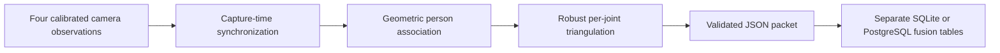

# Internal multi-camera, multi-person simulation

The repository includes a reusable **offline** pipeline for calibrated camera
observations: capture-time synchronization, conservative person association,
robust 3D joint fusion, strict JSON serialization, and durable local ingestion.
The live UI still starts independent single-camera workers. Running this suite
does not connect those workers or replace their exercise angles with metric 3D.



## Run it

From the repository root, using the Python runtime described in
[runtime_setup.md](runtime_setup.md):

```bash
python scripts/simulate_multicamera.py
```

The default estimates intrinsics from detected pixels in rendered checkerboards,
then estimates three relative camera transforms from simultaneous board images.
It replays 15 scenarios with three landmark-noise/transport seeds (7, 42, 99),
18 capture steps each, using that same estimated rig. It writes:

- `artifacts/multicamera_simulation/report.json`: quality checks, errors, source
  counters, identity outcomes, calibration metrics, and example wire packets.
- `multicamera_results.png`: reconstructed versus unavailable joints and errors.
- `local_fusion_<run>.sqlite3`: the actual local ingestion result for this run.

Artifacts are ignored by Git. A failed check produces a nonzero exit status.
Use `--frames`, `--seeds`, `--scenarios`, `--output-dir`, or `--no-plots` to change
the replay. `--ideal-calibration` skips board fitting and isolates the fusion and
transport logic using known virtual cameras. Empty or duplicate test selections
are rejected. OpenCV/NumPy are sufficient without plots; Matplotlib draws plots.

The earlier [calibration simulation](3d_calibration_simulation.md) independently
checks held-out board rays, calibration failure cases, camera spacing, and 3D
angle sensitivity over viewing angles and landmark-noise levels.

## Scenarios and expected behavior

| Scenario | Expected outcome |
| --- | --- |
| One person, four views | One identified person with metric joints |
| Different joints hidden in different cameras; face visible in one | Matching views merge; other views recover hidden joints |
| Wrist visible in only one camera | Wrist remains unavailable; no 3D elbow angle is produced |
| Camera dropout | Remaining visible calibrated views reconstruct the person |
| Arrival jitter, reordering, repeated frames | Capture times drive synchronization; a source frame is used once |
| Mixed camera rates | Available views synchronize without duplicating slower frames |
| One grossly incorrect wrist detection | Other consistent views determine that joint |
| One camera's calibration drifts | The inconsistent view is quarantined |
| Two people in view | Two separate bodies and member assignments |
| Crossing, similar bodies, all faces hidden | Ambiguous associations lose identity and unsupported depth |
| One camera swaps two member labels | Three consistent views recover both people; conflicting views are quarantined |
| Local track ID reused by another person | The new person does not inherit the old member identity |
| Two people without face evidence | Separate geometry can remain anonymous |
| Clock uncertainty exceeds the sync budget | That camera is rejected; healthy views continue |
| Every joint occluded | No metric joints or 3D angles are invented |

Occlusion here means **withheld landmark measurements**. It tests the pipeline's
behavior given missing or incorrect detections, rather than a pose model's
ability to detect a real or rendered occluded human. Ground-truth actor IDs and
3D coordinates are available only to the evaluator, never to association/fusion.

The runner requires every capture step, every accepted source frame, and every
observation in an emitted bundle to be accounted for. Recoverable scenarios must
produce metric bodies and expected angle samples. Checks also forbid mixed
actors, wrong member assignments, reused source frames, and invented single-view
depth. Mean position and angle limits are 20 mm and 3 degrees respectively; the
report also requires p95 below 20 mm / 3 degrees and maxima below 50 mm / 8 degrees.
These are quality gates for this controlled fixture. An unavailable estimate cannot
pass a recoverable scenario merely by having no measured error.

## Verification results

The default replay passed all 45 runs: 3,206 input frames including repeats,
810 synchronized bundles, 33,408 reconstructed joints, and 864 joints recovered
despite being hidden in another associated view. There were zero mixed-person
groups or wrong member assignments. All 810 packet replays were idempotent.
Unavailable/quarantined joint rows remain explicit in the report.

The estimated rig detected all 48 mono boards and all 18 stereo pairs for each
camera. Mono training RMS was 0.0584 px; relative translation errors were
5.50 mm (left), 3.96 mm (right), and 4.24 mm (high). Across the 45 replay runs,
worst-case per-scenario mean/p95/max position and angle errors are retained in
the JSON report rather than inferred from calibration's training RMS.

| Worst value across the 45 runs | Position | Joint angle |
| --- | --- | --- |
| Scenario mean | 5.42 mm | 0.714 degrees |
| Scenario p95 | 10.06 mm | 1.759 degrees |
| Individual maximum | 15.77 mm | 2.665 degrees |

All **171 multi-camera tests and 110 subtests** passed in both the existing
Python 3.10 / OpenCV 4.13 / NumPy 2.2 runtime and isolated pinned Python 3.11 /
OpenCV 4.10 / NumPy 1.26 runtime. Together with calibration tests, the pinned
suite passed 214 tests and 200 subtests. The complete native mirror suite passed
319 tests and 264 subtests.

```bash
PYTHONPATH=Mirror_Code python -m pytest Mirror_Code/tests/test_multicamera_*.py -q
```

Additional integration tests project fast motion at each camera's actual exposure
time. The main replay uses a common pose per capture step with timestamp jitter;
these additional tests change the projected pose with exposure time. They cover
small measured skew, excessive skew, drift, concealed incorrect offsets,
three-person whole-view occlusion and entry/exit, and combined face occlusion,
crossing, camera loss, reordering, duplicates, and stream restart. Exact overlap
is tested using an odd capture count. Mutation controls deliberately remove
geometry, source observations, or elbow angles, and inject a rare large joint
error; each causes the runner to fail.

## Synchronization and association contracts

`FrameSynchronizer` consumes `CameraFrame` objects with source sequence numbers,
fresh stream epochs, capture timestamps, and local receive timestamps. Its clock
convention is `local_capture = camera_capture + clock_offset`. Offsets and their
uncertainty must be obtained independently. The replay allows a 12 ms total
capture interval, including uncertainty, and 100 ms reordering. Arrival time is
used to screen stale/future packets; it never substitutes for capture time.

Buffers, replay history, and retired stream epochs are bounded. Duplicates,
obsolete epochs, timestamp resets, excessive uncertainty, late packets, and
overflow have explicit counters. A camera restart requires explicit reconnect
with a fresh epoch and, if needed, updated clock calibration. Call
`advance_watermark()` from a local timer when sources go silent; call `flush()`
at the end of a finite recording. Fusion independently checks the real corrected
timestamps, even if a caller supplies a forged bundle span.

`MultiCameraFusion` supports one to eight calibrated cameras and at most 64
observations per bundle. Camera-local track IDs are never global member IDs.
Association requires geometric consistency and unique partners. Supplied member
labels cannot override ambiguous geometry. A uniquely supported consistent
camera subset can recover from an isolated mislabeled or bad camera; competing
subsets are quarantined. No temporal identity guess is made when face evidence
is absent. Anonymous person IDs have meaning within their bundle only.

Each metric joint needs at least two distinct supporting optical views, adequate
parallax, positive depth, and consistent reprojection. Distortion is corrected
before triangulation. Per-joint consensus rejects outliers; competing solutions
produce unavailable geometry. Missing points serialize as JSON `null`, with a
boolean validity mask and supporting camera IDs. The metric world frame uses
meters; the virtual rig's front camera is the reference, with positive Y down.

## Local delivery and persistence

`LocalFusionStore` consumes the actual strict JSON boundary. It rejects unknown
fields/schema versions, duplicate JSON fields, nonfinite coordinates, malformed
identities, reused provenance, and inconsistent frame metadata. It writes
`fusion_packets`, `fusion_people`, and `fusion_observations` atomically. These
tables are separate from member exercise history.

Replaying an identical packet is idempotent. Reusing a packet ID with changed
content or a source observation in another packet raises a conflict and rolls
back the entire transaction. A source observation is identified by camera,
stream epoch, sequence number, and local track ID. Empty camera frames have no
observation keys: their replay guarantee is limited to packet ID. This sink does
not implement network delivery, acknowledgements, or a live camera service.

For actual PostgreSQL verification, explicitly point to a **disposable test
database**, never the configured application database:

```bash
export SMART_GYM_FUSION_TEST_PG_DSN='dbname=fusion_test user=test_user host=127.0.0.1 port=5432'
python scripts/simulate_multicamera.py --postgres --ideal-calibration \
  --frames 6 --seeds 42 --no-plots --output-dir artifacts/multicamera_postgres
python scripts/verify_multicamera_postgres.py
```

Both commands require that explicit DSN. The verification script uses unique
namespaces and retains its test rows as evidence. It tests reopen/replay,
conflict rollback, transaction-error recovery, and concurrent connections.

## Before live deployment

Physical rigs still need measured intrinsics/extrinsics, trustworthy capture
timestamps and clock calibration, and recorded human validation. Rolling
shutter, changing focus/exposure, model visibility confidence, real face labels,
and motion during exposure are not established by synthetic detections. A
constant incorrect clock offset cannot always be inferred from a static person.
The time budget limits timestamp disagreement; it does not guarantee accuracy
for arbitrarily fast movement.

Live integration still needs capture workers that emit these calibrated frames,
a shared synchronizer/fusion coordinator, timer/reconnect lifecycle management,
and exercise gates that explicitly accept metric angles and missing joints.
The local fusion schema is not automatically forwarded into the existing
member-history upload API. Keep that integration gated on representative human
recordings and verified member attribution.
